<div align="center">



<a href="https://github.com/tusharsingh3199">
  
</a>

<br/>

<a href="https://github.com/tusharsingh3199"></a>
<a href="https://www.linkedin.com/in/tushar-singh-97526a379/"></a>
<a href="mailto:tusharsingh1346@gmail.com"></a>
<a href="https://www.kaggle.com/tusharsingh3199"></a>
<a href="https://leetcode.com/tusharsingh3199"></a>
<a href="https://youtube.com/@tusharsingh3282"></a>

<br/><br/>


</div>

<p align="center">
Hi, I'm <b>Tushar</b>, a B.Tech student in Artificial Intelligence and Machine Learning at GGSIPU (EDC), Delhi.<br/>
I like building things that <b>see</b>, <b>think</b>, and <b>play</b>.
</p>

<p align="center">
<b>AI / ML</b> &nbsp;·&nbsp; <b>Computer Vision</b> &nbsp;·&nbsp; <b>Game Development</b> &nbsp;·&nbsp; <b>Physics</b> &nbsp;·&nbsp; <b>Web Development</b> &nbsp;·&nbsp; <b>DevOps</b>
</p>

<p align="center">
From 3D medical image segmentation to Unreal Engine combat systems, I enjoy the space where maths, code, and creativity meet,<br/>
and I care about shipping what I build, from model to API to container.
</p>

```bash
pilot@gekkostate:~$ whoami
Tushar Kumar Singh — AI/ML · Computer Vision · Game Dev

pilot@gekkostate:~$ cat pilot.id
BASE      Delhi, India
ACADEMY   GGSIPU (EDC) · B.Tech AI & ML · CGPA 8.86
FOCUS     Computer Vision · Game Dev · Physics · Web · DevOps

pilot@gekkostate:~$ ./ride_the_wave --boot
[ OK ] neural engines ....... PyTorch · TensorFlow · OpenCV
[ OK ] game core ............ Unreal Engine · C++ · Blueprints
[ OK ] web systems .......... React · Node · Django · FastAPI
[ OK ] deploy bay ........... Docker · Kubernetes · AWS · GitHub Actions
[ OK ] compac drive ......... ENGAGED
```

<div align="center">


<br/><br/>


</div>

<table>
  <tr>
    <td width="50%" valign="top">
      <h3>3D Brain Tumor Segmentation</h3>
      <sub><code>Python</code> · <code>TensorFlow</code> · <code>3D U-Net</code> · <code>Swin-UNETR</code> · <code>FastAPI</code></sub>
      <p>End-to-end pipeline for multi-modal MRI (T1, T1ce, T2, FLAIR) using 3D U-Net and Swin-UNETR, with patch-based training, sliding-window inference, and a class-weighted Dice + Cross-Entropy loss to handle severe class imbalance.</p>
      <p><b>0.85 Whole Tumor Dice</b> · deployed with FastAPI and a Streamlit front-end for MRI upload, slice-wise viewing, and downloadable segmentation masks.</p>
      <a href="https://github.com/tusharsingh3199?tab=repositories">View on GitHub →</a>
    </td>
    <td width="50%" valign="top">
      <h3>Infinity Action</h3>
      <sub><code>Unreal Engine</code> · <code>C++</code> · <code>Blueprints</code> · <code>Game AI</code></sub>
      <p>Semi-open-world action RPG with sword and magic combat, varied enemy archetypes, and boss encounters. Enemy AI uses Behavior Trees and AI Perception, with custom UI/UX and interconnected gameplay systems.</p>
      <p><b>50+ FPS</b> on low-end Android hardware through rendering and gameplay optimization.</p>
      <a href="https://github.com/tusharsingh3199?tab=repositories">View on GitHub →</a>
    </td>
  </tr>
</table>

<div align="center">


<table>
  <tr>
    <td align="center" width="25%"><h2>Top 50</h2><sub>of 2,700+ teams<br/>Brainwave Hackathon</sub></td>
    <td align="center" width="25%"><h2>300+</h2><sub>LeetCode problems<br/>solved</sub></td>
    <td align="center" width="25%"><h2>9</h2><sub>freelance game projects<br/>for 7 international clients</sub></td>
    <td align="center" width="25%"><h2>8.86</h2><sub>CGPA, B.Tech AI &amp; ML<br/>GGSIPU (EDC)</sub></td>
  </tr>
</table>

<sub>Technical Member at IoSC GGSIPU-EDC: AI/ML and Computer Vision projects, plus Unreal Engine game development with the i7 Group.</sub>

<br/><br/>


<br/>



<br/>


</div>
